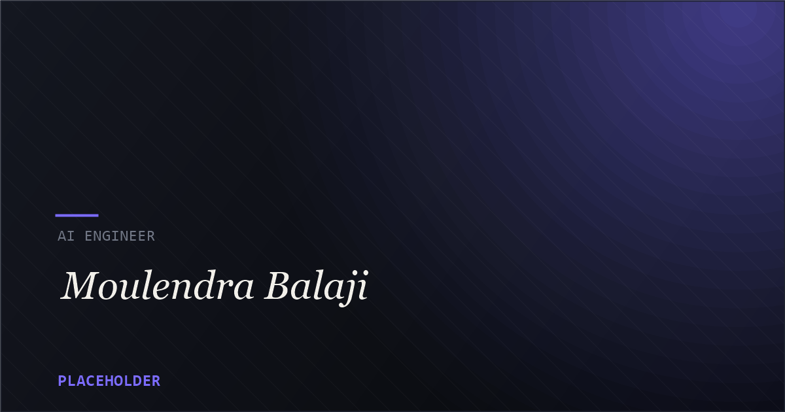

<div align="center">

# Moulendra Balaji — Portfolio

**AI Engineer · Machine Learning · Deep Learning · Web Development**

A fast, accessible, single-page portfolio that turns a résumé into an interactive experience — custom WebGL motion, a content layer edited in one place, and a design system built on *Midnight Ink + Acid Lime*.

[](https://moulendrabalajiportfolio.vercel.app/)
[](https://react.dev/)
[](https://vite.dev/)
[](https://motion.dev/)
[](https://vercel.com/)

[**Live site**](https://moulendrabalajiportfolio.vercel.app/) · [**Report a bug**](https://github.com/MoulendraBalaji/My-Portfolio/issues/new) · [**Request a feature**](https://github.com/MoulendraBalaji/My-Portfolio/issues/new)

</div>



---

## Overview

This repository is the source for my personal portfolio — a single-page site that presents my work across applied machine learning, distributed systems, and product engineering. It is built as a small, deliberately dependency-light React application: no UI framework, no CSS utility library, no runtime styling engine. Every colour resolves through one tokens file, and every string of copy lives in one data module.

The result is a site that is quick to load, easy to keep current, and pleasant to move through — with motion that responds to scroll, a WebGL backdrop behind the hero, and an interface that stays out of the way of the content.

---

## ✨ Features

- **Custom WebGL backdrop** — an animated "slats" hero rendered with [OGL](https://github.com/oframe/ogl), mounted only after the intro so the reveal is intentional.
- **Motion that means something** — scroll-linked parallax, mask-reveal headlines, magnetic buttons, spotlight cards and a sticky project stack, all driven by [`motion`](https://motion.dev/) and fully disabled under `prefers-reduced-motion`.
- **One source of truth for content** — every headline, project, stat and link lives in [`src/data/portfolio.js`](src/data/portfolio.js). The project index is *derived* from that list, so descriptions and images can never drift.
- **SEO without a server** — static Open Graph / Twitter tags ship in `index.html` for crawlers that don't run JS, and are kept in sync at runtime from the same data module.
- **Zero third-party connections on first paint** — Geist, Geist Mono, Instrument Serif and Pacifico are bundled locally through Fontsource rather than pulled from a CDN.
- **Accessible by default** — skip link, visible focus rings, a real focus trap in the mobile menu, semantic landmarks, 44px tap targets, and a strict reduced-motion path.
- **Resilient details** — the résumé button hides itself until the PDF resolves, and project screenshots reserve their layout box up front, so nothing shifts on load.
- **Considered design system** — a compact set of design tokens (*Midnight Ink* surfaces + *Acid Lime* accent) with a fluid type scale that carries from mobile to ultrawide.

---

## 🧱 Tech stack

| Area | Tools |
| --- | --- |
| **Framework** | React 19, Vite 8 |
| **Motion** | `motion` (Framer Motion) — scroll & spring animations |
| **Graphics** | `ogl` (WebGL slat backdrop) |
| **Icons** | `lucide-react` |
| **Typography** | Fontsource — Geist Variable, Geist Mono Variable, Instrument Serif, Pacifico |
| **Styling** | Hand-written CSS with a design-token layer (`src/styles/globals.css`) |
| **Tooling** | ESLint (flat config), npm |

---

## 📁 Project structure

```text
My-Portfolio/
├─ public/
│  ├─ favicon.svg                 # Acid Lime "mb" script wordmark (outlined)
│  ├─ icons.svg                   # shared SVG sprite
│  ├─ Moulendra_Balaji_Resume.pdf
│  └─ images/                     # brand, logos, profile, projects, research
├─ src/
│  ├─ components/
│  │  ├─ layout/                  # Nav, Footer, Cursor, Preloader, ScrollProgress
│  │  ├─ motion/                  # MotionRoot (global motion config)
│  │  ├─ sections/                # Hero, About, Experience, Research, Projects,
│  │  │                           # Skills, Education, Contact
│  │  ├─ MicroSlats/              # small slat motif
│  │  ├─ SlatsBackdrop/           # WebGL backdrop
│  │  ├─ SmartImage/              # image with reserved layout + fallbacks
│  │  └─ ui/                      # CountUp, Magnetic, MaskedText, Reveal, …
│  ├─ data/portfolio.js           # ← single source of truth for all copy
│  ├─ hooks/                      # useActiveSection, useMediaQuery, useEnv, …
│  ├─ lib/                        # meta.js (runtime SEO), motion.js (easings)
│  ├─ styles/                     # fonts.css + globals.css (design tokens)
│  ├─ App.jsx
│  └─ main.jsx
├─ content-structure.md           # original content outline
├─ index.html                     # static meta for crawlers
├─ vite.config.js
└─ package.json
```

---

## 🛠 Getting started

**Prerequisites:** [Node.js](https://nodejs.org/) 20.19+ (LTS recommended) and npm.

```bash
# 1. Clone
git clone https://github.com/MoulendraBalaji/My-Portfolio.git
cd My-Portfolio

# 2. Install
npm install

# 3. Start the dev server (http://localhost:5180)
npm run dev
```

### Scripts

| Command | What it does |
| --- | --- |
| `npm run dev` | Start Vite with hot module replacement on port `5180` |
| `npm run build` | Produce an optimised production build in `dist/` |
| `npm run preview` | Serve the built `dist/` locally |
| `npm run lint` | Run ESLint across the project |

---

## ✍️ Editing content

There is no CMS — the site is its own content. To change anything users read:

1. Open [`src/data/portfolio.js`](src/data/portfolio.js).
2. Edit the relevant export — `meta`, `hero`, `about`, `experience`, `research`, `projects`, `skills`, `achievements`, or `education`.
3. Save. The components pick the change up automatically; no component holds hard-coded copy.

Adding a project is a single object in the `projects` array. Adding it to the curated **Editorial Index** is one slug in `INDEX_SLUGS` — the row's title, description, tech tags and images are derived, so there's nothing to keep in sync by hand.

> The site's `<title>`, description and social cards come from `meta` and are applied at runtime by [`src/lib/meta.js`](src/lib/meta.js). If you change them, update the matching static tags in `index.html` too so crawlers that don't execute JavaScript see the same thing.

---

## 🚀 Deployment

The site is deployed on **Vercel** at **[moulendrabalajiportfolio.vercel.app](https://moulendrabalajiportfolio.vercel.app/)**. Because it builds to static files, any host works.

**Vercel (recommended)**

1. Import this repository at [vercel.com/new](https://vercel.com/new).
2. Framework preset: **Vite** — Build command `npm run build`, output directory `dist`.
3. Deploy.

**Any static host**

```bash
npm run build
# then serve / upload the contents of dist/
```

---

## ♿ Accessibility & performance notes

- All text colours in the token layer pass **WCAG AA** (≥ 4.5:1) against the base background.
- Interactive controls meet the **44px** minimum tap target.
- The mobile menu traps focus and closes on `Escape`; the first tab stop is a **skip link**.
- `prefers-reduced-motion` collapses every animation to a near-instant state, and smooth scrolling is disabled.
- Fonts are self-hosted and **latin-subset** with `font-display: swap`; no CDN is contacted on first paint.

---

## 📬 Contact

**Gundlapalli Moulendra Balaji** — Hyderabad, Telangana, India

[](https://github.com/MoulendraBalaji)
[](https://www.linkedin.com/in/moulendra-balaji-01979b325)
[](mailto:moulendrabalaji2007@gmail.com)

---

<div align="center">

<sub>© 2026 Moulendra Balaji. Designed and built from scratch.</sub>

</div>
